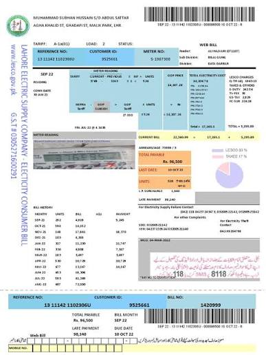
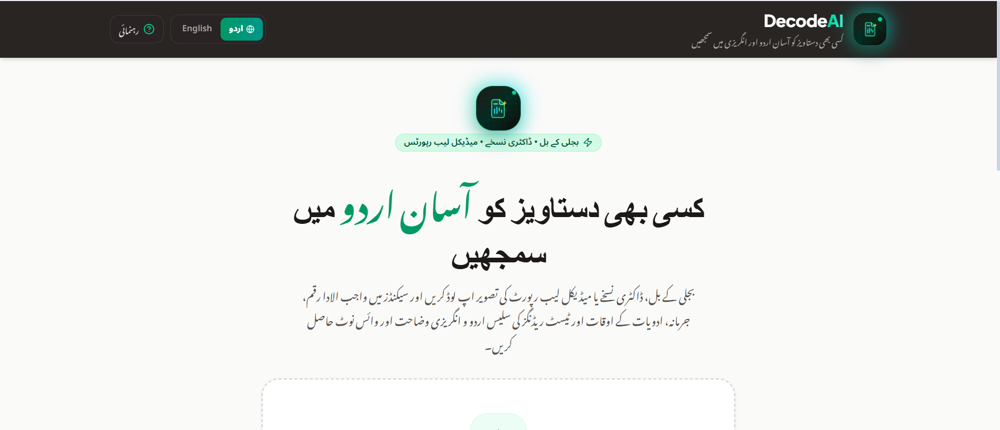
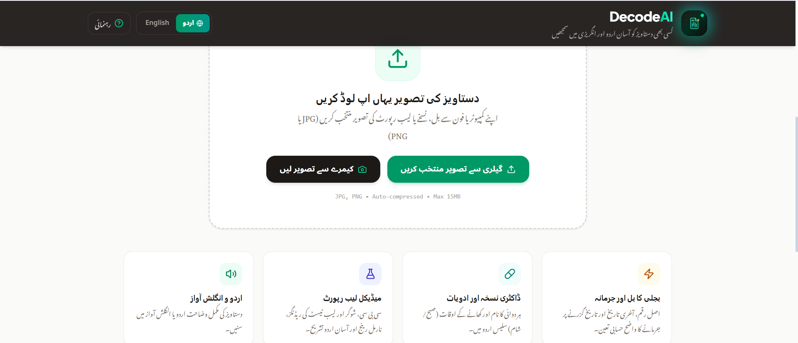
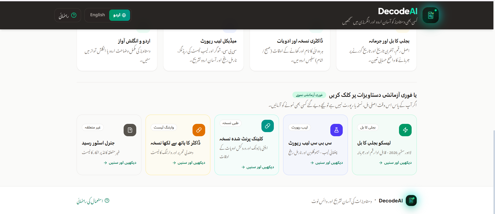
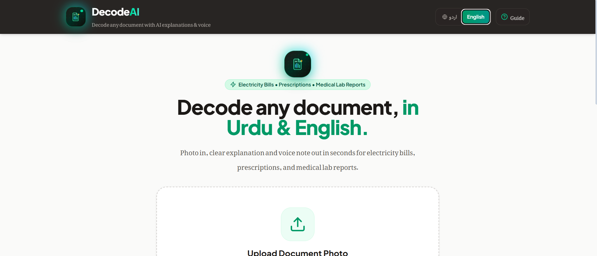
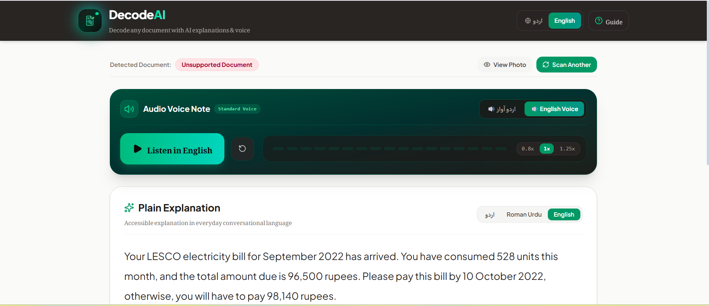
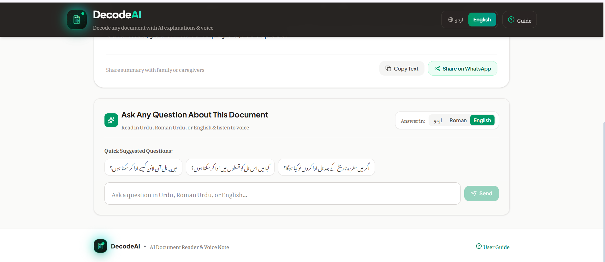

# DecodeAI — Document Understanding & Voice Assistant

> **Tagline:** Decode any document, in Urdu & English. / کسی بھی دستاویز کو آسان اردو اور انگریزی میں سمجھیں

---

## 📌 Overview
**DecodeAI** turns a photo of an everyday document into a simple, clear explanation as **text and an audible voice note** in seconds.

Many people struggle with English-heavy, densely laid out documents such as electricity bills, doctor prescriptions, and medical lab reports. They miss due dates, pay recurring late penalty fees, take medications at incorrect intervals, or struggle to interpret diagnostic lab numbers.

DecodeAI delivers:
- **Instant document analysis:** Fast processing for photos and scans.
- **Dual language text & voice:** Read or listen in simple **Urdu**, **English**, or **Roman Urdu**.
- **Voice accessibility:** Spoken audio note with speed controls (0.8x, 1x, 1.25x) tailored for low-literacy or elderly users.
- **Safety guardrails:** Fixed medical disclaimer for prescriptions and medical reports, code-computed late payment penalties, and flagged warnings for blurred or unclear fields.

---

## 🚀 Supported Documents
1. ⚡ **Electricity Bills:** LESCO, K-Electric, FESCO, IESCO, MEPCO, PESCO, GEPCO, HESCO, QESCO, SEPCO (Amounts, due dates, calculated late penalties, units consumed).
2. 💊 **Doctor Prescriptions:** Clinic prescriptions (medicines, dosages, daily timings like *after meals/before breakfast*, duration).
3. 🧪 **Medical Lab Reports:** Common clinical lab tests (Complete Blood Count / CBC, Blood Sugar / HbA1c, Lipid Profile, Liver & Kidney Function Tests) with biological reference intervals and normal / high / low status flags.

---

## 🎯 Key Features
- **Dual Interface Language:** Instant toggle between Urdu (`اردو`) and English interfaces.
- **Multi-Script Outputs:** Toggle between **اردو (Nastaliq script)**, **Roman Urdu (English alphabet Urdu)**, and **English translation**.
- **Dual Audio Voice Notes:** Listen to explanations spoken in natural Urdu or English.
- **Calculated Late Payment Fee:** Code-computed difference (`Amount After Due Date − Amount Due`), avoiding AI hallucinations.
- **Confidence Badges:** Every key field displays confidence indicators (High, Medium, or Unclear warning).
- **Mandatory Medical & Clinical Disclaimer:** Every prescription and lab report explanation shows a prominent reminder that results are informational and must be reviewed with a qualified doctor.
- **Interactive GenAI Q&A:** Context-aware quick question chips and custom follow-up questions powered by Gemini Flash (e.g. how to pay via JazzCash/Easypaisa or food tips for low hemoglobin) with audio playback in Urdu or English.
- **Instant Testing Samples:** Pre-loaded samples (LESCO Bill, Chughtai Lab CBC Report, Clinic Prescription, Handwritten Prescription with safety warning, and Unsupported receipt test).
- **Mobile Camera & File Upload:** Direct camera viewfinder support with frame guide, flip camera, and client-side auto-compression under 15MB.
- **All Devices Responsive:** Fully optimized for mobile phones (including compact screens), tablets, and desktops.

---

## 🔗 Links
- **Live Demo:** https://YOUR-LIVE-DEMO-LINK
- **Demo Video:** https://drive.google.com/file/d/1qSkPkaAtmERAt2a3WtDDHbiOEi9P8i5h/view?usp=sharing
- **GitHub Repository:** https://github.com/YOUR-USERNAME/decodeai

---

### 🖼️ Screenshots

### Decoded Documents
| Electricity Bill | Medical Report |
|---|---|
|  |  |

### App Screenshots
| | | |
|---|---|---|
|  |  |  |
|  |  |  |

---

## 🛠️ Tech Stack

**Frontend**
- React 19 (`react` / `react-dom` ^19.0.1), written in plain `.jsx`
- Vite ^8.3.0 with `@vitejs/plugin-react` ^6.1.1
- Tailwind CSS ^4.3.3 (`@tailwindcss/vite` ^4.3.3)
- lucide-react ^0.546.0 (icons), motion ^12.23.24 (animations)
- Browser APIs: MediaDevices (camera), Canvas (image compression), Web Speech API (voice fallback)

**Backend**
- Node.js (v18 / 20 / 22 LTS)
- Express ^4.21.2 (REST API: `/api/explain`, `/api/ask`, `/api/tts`, `/api/samples`, `/api/health`)
- dotenv ^17.2.3, tsx ^4.21.0

**AI**
- Google Gen AI SDK `@google/genai` ^2.4.0
- Gemini API (key from Google AI Studio)

**Dev tooling**
- TypeScript ^7.0.2, esbuild ^0.25.0, autoprefixer ^10.4.21

---

## 🤖 AI Methodology & API Usage

```
 Photo / Camera / Sample
          │
          ▼
  [Browser] compress image (Canvas)
          │
          ▼
  [Express server] /api/explain ──► Gemini (vision)
          │                         • detect document type
          │                         • extract key fields + confidence (JSON)
          │                         • explain in Urdu / Roman Urdu / English
          ▼
  [Code guardrails] late fee calculated in code, medical disclaimer,
                    unclear fields flagged, unsupported docs rejected
          │
          ▼
  [Result screen] ──► /api/ask  ──► Gemini (follow-up Q&A)
                  └─► /api/tts  ──► Gemini TTS ──(if fails)──► Browser Web Speech
```

| Feature | Model | What it does |
|---|---|---|
| Document reading & explanation (`/api/explain`) | `gemini-3.1-flash-lite` (fallbacks: `gemini-flash-latest`, `gemini-3.8-flash`) | Reads the photo, extracts key fields with confidence levels as structured JSON, and writes simple explanations in 3 scripts |
| Follow-up Q&A (`/api/ask`) | Same model chain | Answers user questions using the decoded document as context |
| Voice notes (`/api/tts`) | `gemini-3.8-flash-tts` → `gemini-3.8-flash-lite-tts` | Spoken audio (Kore voice for Urdu, Puck for English); falls back to the browser Web Speech API if quota runs out |

**Third-party AI APIs used:** Google Gemini API only.

**Responsible AI guardrails**
- The late payment fee is calculated in code (`Amount After Due Date − Amount Due`), not by the AI.
- Every prescription and lab report shows a fixed medical disclaimer.
- Each field has a High / Medium / Unclear confidence badge.
- Unsupported documents (e.g. shop receipts) are rejected instead of guessed.
- API key stays on the server; it is never sent to the browser or committed to GitHub.

---

## ⚠️ Known Limitations
- Only 3 document types are supported: electricity bills, prescriptions and lab reports.
- Handwritten prescriptions are less reliable; the app shows a warning for unclear text.
- Needs an internet connection and available Gemini API quota.
- Voice notes are capped at 500 characters for fast playback.
- The browser fallback voice depends on the voices installed on the user's device.
- DecodeAI is informational only and is **not a substitute for a doctor**.

## 🔮 Future Improvements
- Support more documents (gas/water bills, bank statements, school notices)
- Offline mode and WhatsApp bot access
- More regional languages (Punjabi, Sindhi, Pashto)
- Medicine reminders from decoded prescriptions

---

## 👥 Team Contributions
- **Bisma Arshad** — Team Lead, Full-Stack Developer, AI/ML integration (Gemini prompts, structured output, TTS), UI/UX design, testing and documentation.

---

## 🙏 Acknowledgements
Built with [React](https://react.dev), [Vite](https://vite.dev), [Tailwind CSS](https://tailwindcss.com), [Express](https://expressjs.com), [lucide-react](https://lucide.dev), [Motion](https://motion.dev) and the [Google Gemini API](https://ai.google.dev). Initial scaffolding was created with Google AI Studio and then customised and tested for this hackathon.

---

## 💻 How to Run in Visual Studio Code (Local Setup - Pure React .jsx)

> **Note:** The entire frontend is written in standard **React with `.jsx`** files (`App.jsx`, `main.jsx`, `components/*.jsx`) and pure JavaScript utilities (`utils/*.js`). No TypeScript annotations are used in the components!

### 1. Prerequisites
- **Node.js** (v18, v20, or v22 LTS recommended): [Download Node.js](https://nodejs.org/)
- **Visual Studio Code**: [Download VS Code](https://code.visualstudio.com/)
- **Google Gemini API Key**: [Get API Key from Google AI Studio](https://aistudio.google.com/app/apikey)

### 2. Download and Open Project
1. Download the project ZIP from the top-right menu in AI Studio (or clone the repository).
2. Extract the ZIP file on your computer.
3. Open **VS Code**, go to **File** ➔ **Open Folder...**, and select the extracted folder.

### 3. Setup Environment Variables
1. Create a `.env` file in the root directory (you can copy `.env.example`):
   ```bash
   cp .env.example .env
   ```
2. Open the `.env` file and paste your Gemini API key:
   ```env
   GEMINI_API_KEY=your_actual_gemini_api_key_here
   ```

### 4. Terminal Commands
Open the terminal in VS Code (`Ctrl + ~` on Windows/Linux or `Cmd + ~` on Mac) and run:

```bash
# 1. Install all dependencies
npm install

# 2. Start the development server (runs backend & frontend on port 3000)
npm run dev
```

### 5. Access the App
Open your browser and navigate to:
```
http://localhost:3000
```

---

## 🚀 Production Build
```bash
npm run build
NODE_ENV=production npm start
```